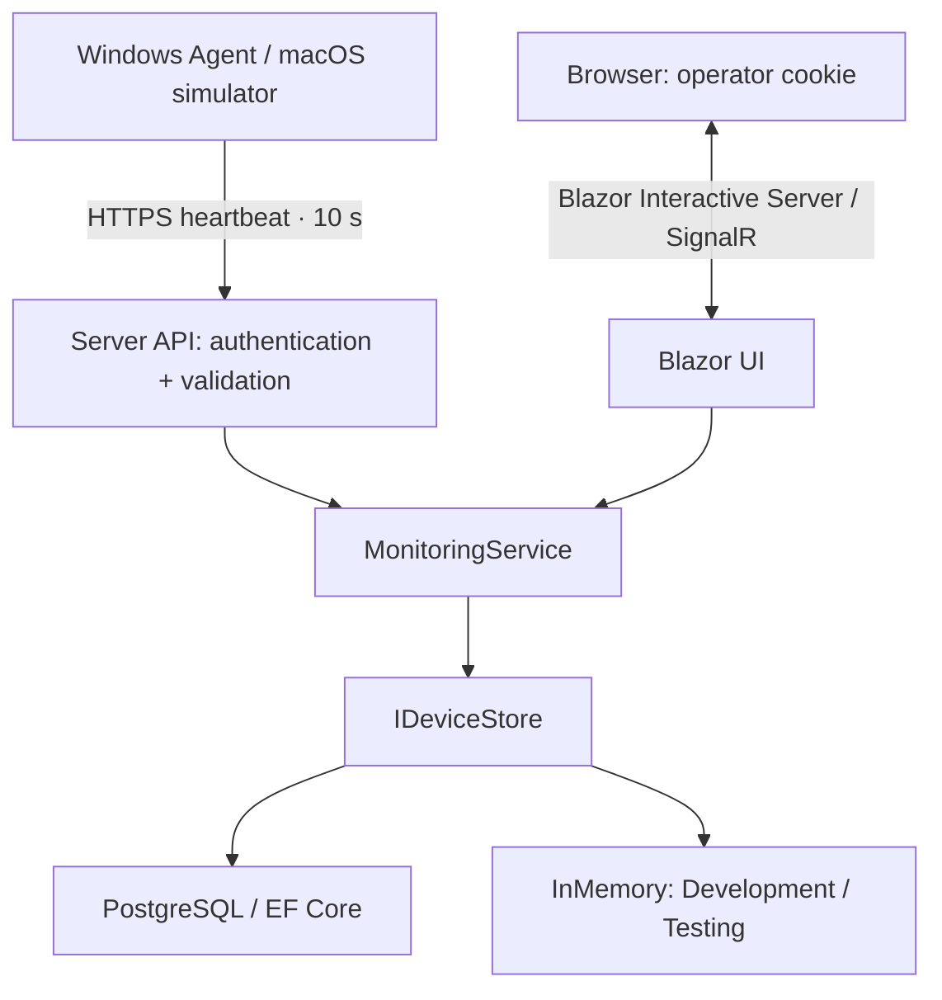

# Архитектура и решения

## Компоненты

Единый сервер объединяет API и Blazor Web App. Agent и Server используют только общую
библиотеку Contracts; они не ссылаются друг на друга. UI использует тот же application
service, что API, с серверной авторизацией на endpoint/circuit, без передачи agent tokens браузеру.

## ADR-001: монолит с границами по ответственности

Четыре проекта достаточны для одного сервера и 100 ПК. В Server разделены Security,
Monitoring, Data и Components, в Agent — Telemetry и Transport. Интерфейсы нужны на
изменяемых границах: ITelemetryCollector, IHeartbeatClient и IDeviceStore.
Без отдельного domain-проекта и инфраструктурных framework до появления сложной бизнес-логики.

## ADR-002: REST для heartbeat, SignalR для UI

Агент делает исходящий POST каждые 10 секунд, без постоянного управляющего канала.
При ошибке собирается новый sample после backoff; старые запросы не накапливаются.
UI раз в 5 секунд читает сервис, а Blazor передаёт render diff браузеру через свой SignalR.
Это не отдельная broadcast-шина событий: custom hub и event-driven обновления добавятся при необходимости.
Offline обновляется даже при полном отсутствии новых heartbeat. На закрытии circuit timer отменяется.

## ADR-003: последнее состояние, атомарный upsert

Таблица Devices хранит один snapshot. PK = заранее provisioned DeviceId.
PostgreSQL INSERT ... ON CONFLICT обновляет строку атомарно. WHERE по серверному
LastSeenAtUtc защищает от отката при конкурентных вызовах, завершившихся в обратном порядке.
В InMemory такой же принцип через ConcurrentDictionary.AddOrUpdate.

Snapshot означает **последний принятый сервером** payload, не максимальный SampledAtUtc.
Поздно доставленный, но допустимый по времени sample может заменить более свежий.
Текущий worker отправляет последовательно, без очереди. Перед добавлением retry payload/offline queue
нужны session/sequence и отдельная защита latest sample от replay/out-of-order.

Метрики сериализуются в ограниченную JSON-строку в text-поле. Это просто и переносимо
для чтения 100 снимков; прогнозам и истории потребуется отдельная time-series модель.
Нельзя наращивать историю внутри этой строки.

## ADR-004: время и статус

SampledAtUtc даёт агент, LastSeenAtUtc — TimeProvider сервера. Статус не хранится:
`serverNow - LastSeenAtUtc > 35 s` → Offline; иначе Online. Данные Offline показываются
как последний snapshot, а не текущие метрики. Все timestamps UTC; клиентские часы не определяют доступность.

## ADR-005: доверие и аутентификация

- Оператор вручную provisioned UUID и 256-bit random token на каждый ПК; саморегистрации нет.
- На сервере SHA256 токенов, сравнение fixed-time; SHA256 подходит случайному высокоэнтропийному токену, не пользовательскому паролю.
- В конфигурации максимум 100 агентов, уникальные UUID и hashes; operator hash отдельный. Пустая/невалидная конфигурация запрещает старт.
- Agent bearer может отправлять только heartbeat своего UUID; operator bearer только читает API.
- UI использует отдельную secure HttpOnly SameSite=Strict cookie на 8 часов, login/logout с antiforgery.
- Все UI/Blazor endpoints требуют operator cookie. Agent token не открывает UI. Login rate limit 5/min/IP; heartbeat 30/min/identity.
- HTTPS обязателен; HTTP отвергается до обработки credentials. AllowedHosts задаётся списком допустимых имён сервера.
- TLS системные roots или явный TrustedCaPath. Проверяются hostname, срок, цепочка и serverAuth.
  В custom-root режиме учитываются переданные intermediates, AIA downloads отключены, CRL/OCSP пока не проверяются.
- Dev CA создаётся скриптом только для localhost/127.0.0.1, 30 дней; в системное доверие автоматически не устанавливается.
- Cookie/DataProtection keys для production нужно хранить устойчиво с защитой и ACL; индивидуальные пользователи/RBAC и административный отзыв сессий пока следующий этап.
- UI-сессии имеют случайный ID и серверный срок в volatile registry одного сервера. Logout отзывает
  текущую сессию во всех её вкладках, cookie replay отклоняется; независимые входы сохраняются.
  Перезапуск сервера завершает все UI-сессии, в том числе cookies, выданные до hardening.
- Circuit повторно проверяет сессию каждую секунду; Home скрывает защищённое содержимое через
  AuthorizeView и проверяет сессию перед чтением и после ожидания хранилища. Это не гарантирует
  физическое закрытие WebSocket и не удаляет ранее доставленные клиенту данные.

## ADR-006: macOS и зависимости агента

Реальный collector использует GetSystemTimes, GlobalMemoryStatusEx, GetTickCount64 и DriveInfo;
Windows API помечен SupportedOSPlatform. CPU — системный, kernel включает idle; первый sample null.
Симулятор включается только --simulate, генерирует синтетические Windows-метрики; uptime в нём — время работы симулятора.
Ошибки чтения отдельного диска логируются и не прерывают сбор остальных.

Для стартового cross-platform worker используется Hosting/Http из shared framework
Microsoft.AspNetCore.App: framework-dependent Agent требует ASP.NET Core Runtime 10.
Это позволяет проверить основной код с установленным SDK без дополнительных Hosting-пакетов.
Windows deployment рекомендован self-contained: Runtime на ПК не нужен, HTTP-сервер в Agent не запускается.
AddWindowsService подключается отдельным package только при Windows host или win-* RuntimeIdentifier;
его восстановление и Windows execution проверяются на Windows, не подменяются симуляцией.

## ADR-007: PostgreSQL и development store

Production — только PostgreSQL/EF Core. InMemory — явно выбранный opt-in для Development/Testing,
не сохраняет данные и не используется как fallback. SQLite в этом инкременте не используется.
EF migration и snapshot входят в repo; DDL применяется отдельным запуском
`--Database:ApplyMigrations=true`, после чего процесс завершается. Обычный запуск не меняет схему.
Readiness делает запрос Devices, проверяя схему и соединение; liveness проверяет процесс.
Схему и SQL можно проверить офлайн без работающего PostgreSQL, но это не заменяет integration-тест провайдера.

## До промышленного внедрения

Windows smoke-test/SCM recovery и installer, PostgreSQL integration и backup/restore,
100-agent load/soak, ротация/отзыв tokens, operator accounts/RBAC, защищённый DataProtection keyring,
TLS renewal/revocation, аудит и operational metrics. Состояние работ — в tasks.md и verification.md.

## Первичные технические источники

- [Npgsql EF Core 10](https://www.npgsql.org/efcore/release-notes/10.0.html).
- [Microsoft: Windows Worker Service](https://learn.microsoft.com/en-us/dotnet/core/extensions/windows-service).
- [Microsoft: Blazor security](https://learn.microsoft.com/en-us/aspnet/core/blazor/security/?view=aspnetcore-10.0).
